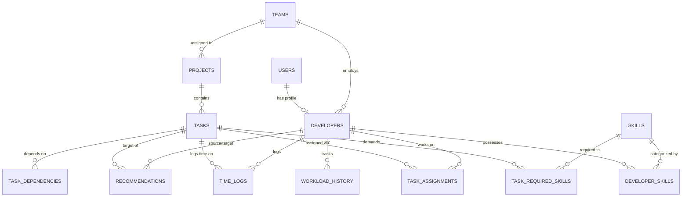

# WorkSense AI — Database Design Specification

## 1. Schema ERD Overview

---

## 2. Normalized Tables Catalog

### 1. `users`
- `id`: Integer, Primary Key, Indexed
- `name`: String(255), Nullable=False
- `email`: String(255), Unique, Indexed, Nullable=False
- `password_hash`: String(255), Nullable=False
- `role`: String(50), Enum ('admin', 'project_manager', 'developer')
- `is_active`: Boolean, Default=True
- `created_at`: DateTime(timezone=True)
- `updated_at`: DateTime(timezone=True)

### 2. `teams`
- `id`: Integer, Primary Key, Indexed
- `team_name`: String(255), Unique, Nullable=False
- `description`: Text, Nullable=True
- `created_at`: DateTime(timezone=True)

### 3. `developers`
- `id`: Integer, Primary Key, Indexed
- `user_id`: Integer, FK(users.id, CASCADE), Unique, Nullable=False
- `team_id`: Integer, FK(teams.id, SET NULL), Nullable=True
- `experience_level`: String(50), ('junior', 'mid', 'senior', 'lead')
- `available_hours_per_week`: Numeric(5, 2), Default=40.00
- `active_status`: Boolean, Default=True

### 4. `skills`
- `id`: Integer, Primary Key, Indexed
- `skill_name`: String(100), Unique, Nullable=False
- `description`: Text, Nullable=True

### 5. `developer_skills`
- `id`: Integer, Primary Key, Indexed
- `developer_id`: Integer, FK(developers.id, CASCADE), Nullable=False
- `skill_id`: Integer, FK(skills.id, CASCADE), Nullable=False
- `proficiency_level`: Integer, Check (1 to 5)
- Constraint: `UniqueConstraint("developer_id", "skill_id")`

### 6. `projects`
- `id`: Integer, Primary Key, Indexed
- `project_name`: String(255), Nullable=False
- `description`: Text, Nullable=True
- `team_id`: Integer, FK(teams.id, SET NULL), Nullable=True
- `start_date`: Date, Nullable=True
- `end_date`: Date, Nullable=True
- `status`: String(50), Default='active'
- `created_at`: DateTime(timezone=True)

### 7. `tasks`
- `id`: Integer, Primary Key, Indexed
- `project_id`: Integer, FK(projects.id, CASCADE), Nullable=False
- `task_name`: String(255), Nullable=False
- `description`: Text, Nullable=True
- `complexity`: String(50), ('easy', 'medium', 'hard', 'critical')
- `priority`: String(50), ('low', 'medium', 'high', 'critical')
- `estimated_hours`: Numeric(6, 2), Nullable=False
- `status`: String(50), ('pending', 'in_progress', 'blocked', 'completed')
- `deadline`: Date, Nullable=True
- `created_at`: DateTime(timezone=True)
- `updated_at`: DateTime(timezone=True)

### 8. `task_assignments`
- `id`: Integer, Primary Key, Indexed
- `task_id`: Integer, FK(tasks.id, CASCADE), Nullable=False
- `developer_id`: Integer, FK(developers.id, CASCADE), Nullable=False
- `assigned_date`: DateTime(timezone=True)
- `allocation_percentage`: Numeric(5, 2), Default=100.00
- Constraint: `UniqueConstraint("task_id", "developer_id")`

### 9. `task_required_skills`
- `id`: Integer, Primary Key, Indexed
- `task_id`: Integer, FK(tasks.id, CASCADE), Nullable=False
- `skill_id`: Integer, FK(skills.id, CASCADE), Nullable=False
- `minimum_proficiency`: Integer, Check (1 to 5)
- Constraint: `UniqueConstraint("task_id", "skill_id")`

### 10. `time_logs`
- `id`: Integer, Primary Key, Indexed
- `task_id`: Integer, FK(tasks.id, CASCADE), Nullable=False
- `developer_id`: Integer, FK(developers.id, CASCADE), Nullable=False
- `hours_spent`: Numeric(6, 2), Nullable=False
- `log_date`: Date, Default=current_date
- `description`: Text, Nullable=True

### 11. `task_dependencies`
- `id`: Integer, Primary Key, Indexed
- `task_id`: Integer, FK(tasks.id, CASCADE), Nullable=False
- `depends_on_task_id`: Integer, FK(tasks.id, CASCADE), Nullable=False
- Constraint: `UniqueConstraint("task_id", "depends_on_task_id")`

### 12. `workload_history`
- `id`: Integer, Primary Key, Indexed
- `developer_id`: Integer, FK(developers.id, CASCADE), Nullable=False
- `workload_score`: Numeric(5, 2), Nullable=False
- `utilization_percentage`: Numeric(6, 2), Nullable=False
- `workload_status`: String(50), Nullable=False
- `calculated_at`: DateTime(timezone=True)

### 13. `recommendations`
- `id`: Integer, Primary Key, Indexed
- `task_id`: Integer, FK(tasks.id, CASCADE), Nullable=False
- `from_developer_id`: Integer, FK(developers.id, CASCADE), Nullable=False
- `suggested_developer_id`: Integer, FK(developers.id, CASCADE), Nullable=False
- `recommendation_reason`: Text, Nullable=False
- `status`: String(50), Default='pending' ('pending', 'approved', 'rejected')
- `created_at`: DateTime(timezone=True)
