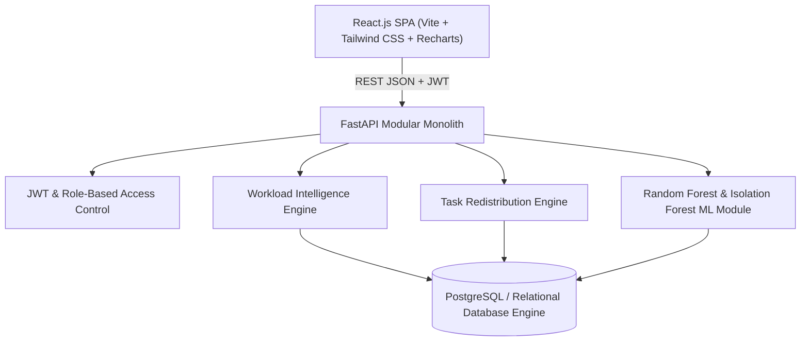

# WorkSense AI — System Architecture Specification

## 1. Overview
**WorkSense AI** (Developer Workload Imbalance Detector) is an intelligent full-stack SaaS application designed to calculate developer workload scores, identify workload imbalances across software engineering teams, predict actual task completion effort using machine learning, and recommend feasible task redistributions with human-in-the-loop managerial oversight.

---

## 2. Architectural Blueprint

---

## 3. Core Intelligence Engine Formulation

### A. Task Remaining Effort
Active tasks contribute remaining effort based on:
$$\text{Remaining Hours} = \max(0, \text{Estimated Hours} \times \text{Allocation \%} - \text{Actual Hours Logged})$$

- Completed tasks contribute $0.0$ remaining hours.
- Multiple assigned developers divide effort proportional to their allocation percentage.

### B. Complexity Weighting
Task complexity modifies required cognitive capacity:
- Easy: $1.0\times$
- Medium: $1.2\times$
- Hard: $1.5\times$
- Critical: $2.0\times$

$$\text{Weighted Remaining Effort} = \sum_{t \in \text{Active Tasks}} \left( \text{Remaining Hours}_t \times \text{Weight}_t \right)$$

### C. Capacity Utilization Percentage
$$\text{Capacity Utilization \%} = \left( \frac{\text{Weighted Remaining Effort}}{\text{Available Capacity (Weekly Working Hours)}} \right) \times 100$$

### D. Classification Thresholds
- **Underutilized:** $< 40.0\%$
- **Balanced:** $40.0\% \le \text{Utilization} \le 80.0\%$
- **High Workload:** $80.0\% < \text{Utilization} \le 100.0\%$
- **Overloaded:** $> 100.0\%$

---

## 4. Machine Learning Module

### A. Random Forest Regressor (Task Effort Prediction)
- **Inputs:** Task complexity, priority, estimated hours, developer experience level, required skill count, average skill proficiency.
- **Output:** Predicted actual completion hours and 95% confidence interval bounds.
- **Evaluation:** MAE = 1.79 hours, RMSE = 2.55 hours, $R^2 = 0.963$.

### B. Isolation Forest (Workload Anomaly Detection)
- Detects non-linear workload concentration and fatigue risk outliers across multi-dimensional feature space (utilization percentage, weighted remaining hours, active task counts).

---

## 5. Redistribution Recommendation Engine
When an overloaded developer ($\ge 80\%$) has reassignable active tasks:
1. Filters active, non-blocked tasks whose prerequisite dependencies are cleared.
2. Identifies qualified recipient candidates possessing required skills and minimum proficiency.
3. Simulates post-reassignment utilization for both original and candidate developers.
4. Ensures candidate does not exceed balanced threshold ($80\%$).
5. Ranks proposals by composite score (Skill Match \% + Capacity Slack).
6. Presents proposal to Project Manager; requires approval before database re-assignment is committed.
